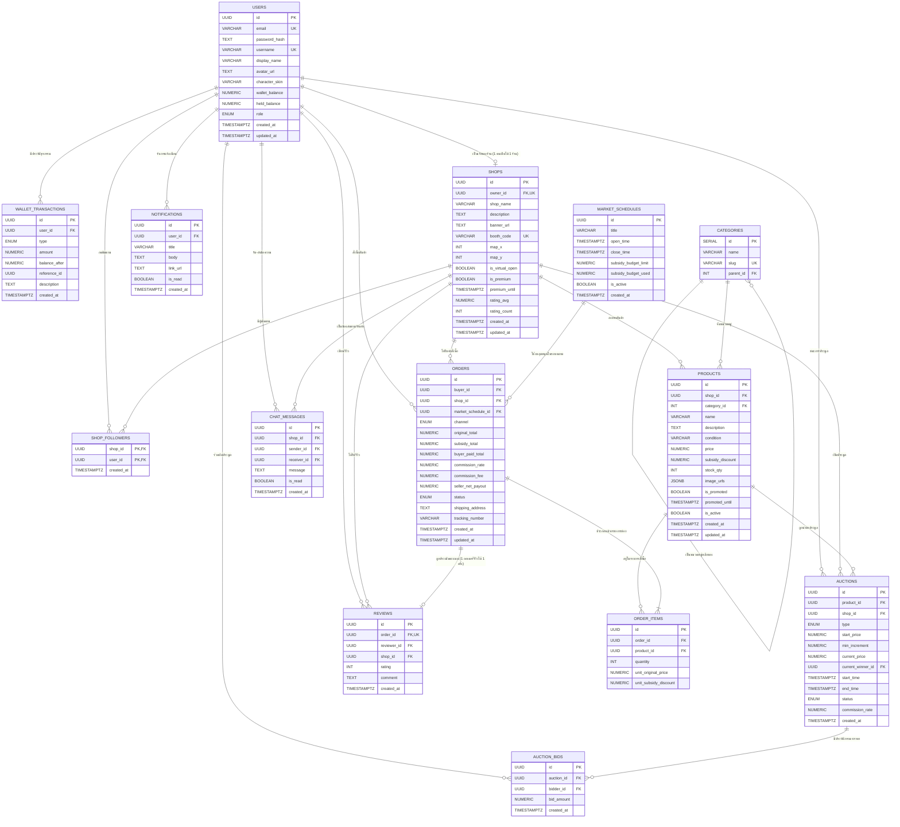

<<<<<<< HEAD
# 🌐 Visual Marketplace

<p align="center">
  <strong>แพลตฟอร์มตลาดนัดเสมือนจริง 2D Interactive Virtual Marketplace</strong><br>
  ผสมผสานการช้อปปิ้งแบบ E-Commerce เข้ากับประสบการณ์เดินตลาดจำลองแบบ Real-time
</p>

<p align="center">
  
  
  
  
  
  
  
</p>

---

## 📖 สรุปภาพรวมโครงการ (Project Overview)

**Visual Marketplace** เป็นแพลตฟอร์มการซื้อขายสินค้าออนไลน์ที่นำเสนอมุมมองแบบ **Virtual 2D Map** ผู้ใช้งานสามารถเลือกตัวละคร Avatar เดินสำรวจร้านค้าตามพิกัดบูธต่าง ๆ ร่วมงานอีเวนต์ตลาดนัดตามตารางเวลา พร้อมรับเงินอุดหนุนส่วนลด และร่วมประมูลสินค้าได้แบบ Real-time

### ✨ ฟีเจอร์หลัก (Core Features)

* **🗺️ Virtual 2D Map & Booths:** เดินสำรวจบูธร้านค้าบนแผนที่จำลองตามพิกัด `(x, y)` พร้อมดูสถานะการเปิดร้านเสมือนจริง (`is_virtual_open`)
* **🛍️ E-Commerce & Shop Management:** ระบบร้านค้า (1 บัญชีเปิดได้ 1 ร้านค้า), จัดหมวดหมู่สินค้า (`CATEGORIES`), ติดตามร้าน (`SHOP_FOLLOWERS`) และรีวิวหลังสั่งซื้อ
* **🔨 Real-time Live Auction:** ห้องประมูลสินค้าสด รองรับการเคาะราคาแข่งขันแบบ Real-time (`AUCTION_BIDS`) พร้อมระบบล็อกยอดเงินมัดจำ
* **🎪 Market Schedules & Subsidies:** จัดรอบตลาดนัดตามช่วงเวลา พร้อมระบบงบสนับสนุนส่วนลด (`subsidy_discount`) เพื่อกระตุ้นยอดขายในแต่ละรอบ
* **💰 E-Wallet System:** กระเป๋าเงินดิจิทัลในตัว จัดการยอดเงินพร้อมใช้ (`wallet_balance`) และยอดที่ถูกระงับเพื่อประมูล/สั่งซื้อ (`held_balance`)
* **💬 Real-time Chat & Notifications:** ระบบแชทสนทนาระหว่างผู้ซื้อและร้านค้า พร้อมการแจ้งเตือนกิจกรรมสำคัญในระบบ

---

## 🛠️ สถาปัตยกรรมเทคโนโลยี (Tech Stack)

| ส่วนของระบบ | เทคโนโลยีที่เลือกใช้ | รายละเอียด |
| :--- | :--- | :--- |
| **Frontend** | Next.js 16 (App Router), React 19, TypeScript | พัฒนาหน้าเว็บ Interactive และการแสดงผลแผนที่ |
| **Styling** | Tailwind CSS v4 | ตกแต่งหน้าตาแบบโมเดิร์น Responsive |
| **Backend** | Node.js, Express 5, TypeScript | พัฒนา REST APIs และ Business Logic |
| **Real-time** | Socket.io / WebSocket | จัดการการเคลื่อนที่บนแผนที่, การประมูล และระบบแชทสด |
| **Database** | PostgreSQL | ฐานข้อมูลเชิงสัมพันธ์ รองรับ UUID, JSONB และ Transaction ความปลอดภัยสูง |

---

## 🗄️ แผนผังฐานข้อมูล (Entity Relationship Diagram)



---

## 📚 สรุปความหมายของแต่ละตาราง (Database Dictionary)

| ตาราง (Table) | หน้าที่และความรับผิดชอบ |
| :--- | :--- |
| `USERS` | บัญชีผู้ใช้งาน ข้อมูลโปรไฟล์ สกินตัวละคร และยอดคงเหลือในกระเป๋าเงิน |
| `WALLET_TRANSACTIONS` | บันทึกประวัติรายการเงินเข้า/ออก (เติมเงิน, ซื้อสินค้า, จ่ายค่าประมูล, ถอนเงิน) |
| `SHOPS` | ข้อมูลร้านค้า ตำแหน่งบูธบนแผนที่ 2D (`map_x`, `map_y`) และสถานะเปิดร้านจำลอง |
| `SHOP_FOLLOWERS` | การติดตามร้านค้าของผู้ซื้อ (Many-to-Many ระหว่าง User กับ Shop) |
| `MARKET_SCHEDULES` | รอบเวลาเปิดตลาดพิเศษ พร้อมวงเงินงบอุดหนุนส่วนลดประจำรอบ |
| `CATEGORIES` | หมวดหมู่สินค้า รองรับโครงสร้างแบบลำดับชั้น (Hierarchical / Parent-Child) |
| `PRODUCTS` | ข้อมูลรายการสินค้า ราคา สต็อก รูปภาพ และส่วนลดพิเศษ |
| `ORDERS` | คำสั่งซื้อ รายละเอียดช่องทางสั่งซื้อ ยอดชำระ ส่วนลดอุดหนุน และสถานะจัดส่ง |
| `ORDER_ITEMS` | รายการสินค้าย่อยในแต่ละออเดอร์ บันทึกราคาและส่วนลด ณ ตอนสั่งซื้อ |
| `AUCTIONS` | ห้องประมูลสินค้า ราคาเริ่มต้น ราคาขั้นต่ำ และผู้ชนะประมูลปัจจุบัน |
| `AUCTION_BIDS` | ประวัติการเคาะราคาบิดประมูลของผู้เข้าร่วม |
| `REVIEWS` | คะแนนและความคิดเห็นต่อร้านค้า (ผูกกับคำสั่งซื้อ ป้องกันการรีวิวปลอม) |
| `CHAT_MESSAGES` | ข้อความสนทนาระหว่างผู้ซื้อและร้านค้าแบบ Real-time |
| `NOTIFICATIONS` | กล่องข้อความแจ้งเตือนสถานะคำสั่งซื้อ การประมูล และกิจกรรมต่าง ๆ |

---

## 📁 โครงสร้างโปรเจกต์ (Project Structure)

```text
visual-marketplace/
├── frontend/               # Next.js 16 Web Application
│   ├── src/
│   │   └── app/            # App Router pages & layouts
│   ├── public/             # Static assets & game sprites
│   └── package.json
├── backend/                # Express 5 REST API & Realtime Server
│   ├── src/
│   │   ├── configs/        # Database & Environment configs
│   │   ├── controllers/    # API Controllers
│   │   ├── middlewares/    # Auth, Validation middlewares
│   │   ├── services/       # Core Business logic
│   │   └── sockets/        # WebSocket/Socket.io handlers
│   ├── app.ts
│   └── package.json
└── README.md               # Project documentation
```

### ER Diagram

>>>>>>> e7b1289d01c182ed1bee59a4ed1e9e5d921a91e8


